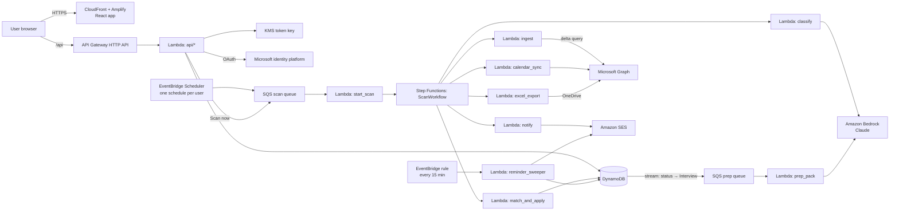

# Design Document

## Overview

The system is a serverless AWS app with three parts:

1. **Web app + API**: sign-in with Microsoft, onboarding, dashboard, applications, analytics, prep packs, settings, Excel download.
2. **Scan agent**: a Step Functions workflow per user that reads new mail from Microsoft Graph, prefilters it, classifies it with Claude on Amazon Bedrock, matches it to applications, applies status rules, extracts deadlines, then syncs the calendar, writes the Excel file to OneDrive and notifies the user.
3. **Background jobs**: per-user scan schedules, a reminder sweeper, and prep-pack generation.

The agent's "brain" (classification, extraction and prep packs) is the LLM. Everything with rules (matching, status changes, furthest stage, manual-edit precedence, Excel layout) is plain code, so it's predictable and testable.

## Architecture



### Why this shape
- **Step Functions** gives retries, resumable state and visibility per scan without a long-running server.
- **SQS in front of scans** smooths load so many users scheduled at 08:00 don't hit Graph throttling or Bedrock quotas together. Concurrency is capped on `start_scan`.
- **Bedrock AgentCore** is not needed for v1 because the agent is a fixed pipeline, not an open-ended tool-using agent. If later versions add a chat agent ("mark Optiver as interview", "what's due this week?"), host it on AgentCore Runtime with AgentCore Identity holding the Microsoft tokens.

## Components and Interfaces

### Auth (`backend/api/auth.py`)
- `GET /api/auth/login` builds the Microsoft authorize URL (MSAL `initiate_auth_code_flow`, PKCE, `state`, `nonce`) and stores the flow in a short-lived DynamoDB item (TTL 10 min).
- `GET /api/auth/callback` exchanges the code, validates the ID token, upserts the user, encrypts the refresh token with KMS (`EncryptionContext={"user_id": ...}`) and sets the session cookie (signed JWT, 7-day sliding expiry, `HttpOnly; Secure; SameSite=Lax`).
- `POST /api/auth/logout` and `DELETE /api/me` (delete account, see Requirement 14.4).
- Access tokens are never stored. `integrations/graph_client.py` gets a fresh one per scan from the refresh token, then saves the rotated refresh token.

### Ingest (`agent/ingest`)
- Per folder: `GET /me/mailFolders/{id}/messages/delta?$select=id,conversationId,internetMessageId,subject,from,toRecipients,receivedDateTime,sentDateTime,bodyPreview` with `Prefer: odata.maxpagesize=50`.
- First scan: the delta call is filtered with `receivedDateTime ge {backfill_start}`. Later scans use the saved `deltaLink` per folder. A one-day overlap comes from also re-checking messages received in the last 24h that are not yet in `ProcessedMessage`.
- **Prefilter** (`prefilter.py`) uses only the subject, sender and `bodyPreview`, and passes a message if:
  - the sender domain is in `ATS_DOMAINS` or the user's known application senders, OR
  - subject/preview matches the keyword regex (application, applying, applied, unfortunately, interview, assessment, candidate, offer, next steps, shortlist, video interview, online test, HireVue, SHL, Pymetrics, Arctic Shores, Codility, HackerRank, TestGorilla), AND
  - the sender is not on the blocklist (job-alert senders, marketing, `noreply` of known newsletters, university admissions domains) and the user hasn't marked it "not a job email".
- Messages that pass are fetched in full (`GET /me/messages/{id}?$select=body` with `Prefer: outlook.body-content-type="text"`). Signatures and quoted replies are stripped and the text is cut to 4,000 characters. The body stays in Lambda memory only.

### Classify (`agent/classify`)
- One Bedrock `Converse` call per message, using tool use with a single tool `record_email_facts` whose input schema is `EmailFacts` (below). `temperature=0`.
- The system prompt holds the definitions from requirements (email types, statuses, the not-an-application list), the user's time zone and today's date, and few-shot examples taken from anonymised real cases:
  - an ATS confirmation (Workday)
  - a soft rejection ("we will not be progressing")
  - an assessment invite with a relative deadline ("within five days of this email")
  - an "eligibility error, application reopened" correction (Optiver case)
  - an emailed CV in Sent Items
  - a recruiter spam "interview" email (not an application)
  - a university admissions email (not an application)
- Output is validated with Pydantic. On failure it retries once with the validation error, then falls back to `Check email`.

```python
class EmailFacts(BaseModel):
    is_job_application_email: bool
    email_type: Literal["confirmation","assessment_invite","interview_invite","rejection","offer",
                        "role_closed","incomplete_application_reminder","assessment_completed",
                        "assessment_expired","progress_update","other"]
    company: str | None
    role: str | None
    programme: Literal["Graduate","Internship","Experienced hire","Not stated"] = "Not stated"
    requisition_id: str | None
    applied_via: str | None          # e.g. "Workday", "Greenhouse", "LinkedIn", "Dartmouth Partners"
    stage_reached: FurthestStage | None
    deadline: datetime | None        # resolved to an absolute time in the user's tz
    deadline_kind: Literal["explicit","estimated"] | None
    deadline_text: str | None        # what's due, e.g. "SHL online assessment"
    interview_datetime: datetime | None
    interview_location: str | None
    summary: str = Field(max_length=140)   # ≤ 20 words
    confidence: float = Field(ge=0, le=1)
```

### Match and apply (`agent/match`)
- **Normalisation:** lowercase; strip legal suffixes (plc, ltd, llp, inc, group, & co, capital, securities, technologies, recruiting, careers, early careers); map aliases from the firm directory (e.g. "Citigroup" → "Citi", "BNP Paribas Recruitment" → "BNP Paribas", "warburgpincus@dartmouthpartners.com" → "Warburg Pincus").
- **Matching order:**
  1. exact `requisition_id`
  2. same `conversationId` as an earlier event
  3. same normalised company AND role similarity ≥ 0.75 (token-set ratio)
  4. same normalised company where the user has exactly one non-closed application
  5. otherwise, a new application (only for the email types listed in Requirement 4.2)
- **Status state machine** (pure function `apply_event(app, event) -> AppPatch`):

| Event type | New status | Furthest stage (only forward) |
|---|---|---|
| confirmation | Awaiting response (unless already further) | Applied |
| assessment_invite | Assessment stage | Online assessment |
| assessment_completed | (unchanged) | Online assessment; closes matching deadline |
| interview_invite | Interview | from `stage_reached` or Interview |
| offer | Offer | Offer |
| rejection | Rejected | (unchanged) |
| role_closed | Closed by employer | (unchanged) |
| incomplete_application_reminder | Not submitted (only if app is new or already Not submitted) | Started |
| assessment_expired | Closed | (unchanged) |
| progress_update | from `stage_reached` | from `stage_reached` |

  - An event older than `app.last_update` adds to the timeline only and does not change fields.
  - Fields with `manual_edited_at` newer than the event are not changed (Requirement 4.6).
  - "Gone quiet" is computed at read time from `last_update`, not stored.
- **Firm type:** look up `domain/firm_directory.yaml` (seeded with ~300 UK finance and graduate employers, including every firm in the reference tracker), then the user's overrides, then the model (a separate small Bedrock call, cached per company globally).

### Excel export (`backend/excel`)
- `build_workbook(user, apps, deadlines, tasks, scans) -> bytes` ports the original builder (`reference/build_tracker.py`) and the Priorities sheet from the live tracker (`reference/Job_Applications_Tracker.xlsx`), and adds the Email link column. Same fonts, widths, colours, validations, conditional formats and Summary formulas.
- **Priorities** rows come from: open Deadlines (`1 - Urgent` if due within 3 days, `2 - High` within 7), non-"None" next steps on active applications (`2 - High`), `Check email` items (`2 - High`) and gone-quiet applications (`3 - Medium`). Manual rows are stored as `Task` items (`USER#{uid}` / `TASK#{id}`, source=manual) and written back unchanged.
- `import_edits(xlsx_bytes, apps) -> list[ManualEdit]` reads the Applications table by header name (not position) and diffs Status, Firm type, Programme, Next step and Notes against stored values. Rows are matched by a hidden column `App ID` (hidden in the sheet). It also reads Priorities: Done? = Yes marks the matching deadline or task done, and new Manual rows become Task items.
- OneDrive: `GET /me/drive/root:/Job Search/Job_Applications_Tracker.xlsx` gets `lastModifiedDateTime` + eTag. If it was modified after the last export, edits are imported first. Then the file is uploaded with `PUT .../content` and `If-Match: {eTag}`. On 412 (changed meanwhile) it re-imports and retries once. On 423 (locked) it retries in 10 minutes, up to 3 times.

### Deadlines and reminders
- `Deadline` items are created by `match_and_apply`. The reminder schedule is precomputed into `remind_at` timestamps (due − 48h, 08:00 local on the due day), written to a GSI keyed by `REMIND#{yyyy-mm-ddThh:mm}` in 15-minute buckets.
- `reminder_sweeper` runs every 15 minutes: it queries the current bucket, sends one SES email per user that groups all due items, and marks each reminder as sent (idempotent with a conditional write).

### Calendar sync (`integrations/graph_calendar.py`)
- Creates events with `singleValueExtendedProperties` `String {GUID} Name JobTrackerId = {deadline_id|app_id}` so the app's own events can be found and only those are touched.
- Deadlines: all-day events when only a date is known, otherwise 30 minutes ending at the deadline; reminder 24h before. Interviews: timed events with location/online link.
- Changes update the event by stored `event_id`. Cancellation deletes the event. Turning sync off offers bulk delete by extended property.

### Prep packs (`agent/prep`)
- Triggered from a DynamoDB stream when furthest stage reaches Interview or later.
- Input: application fields, the interview email's extracted facts, the firm directory entry, and the user's role focus (from onboarding: e.g. "quant/trading", "IB", "consulting").
- One Bedrock call with a larger Claude model and a structured `PrepPack` schema (sections from Requirement 10.2). Each claim is tagged with `source: "email" | "general_knowledge"`. The prompt forbids specific recent facts (deals, people, figures, dates) unless they are in the email.
- Shown in the app and exportable to PDF (server-side HTML → PDF via a headless Chromium Lambda layer, or client-side print CSS for v1).

### Analytics (`backend/api/analytics.py`)
- Computed on request from the user's applications (typically < 500 rows, so no warehouse needed). Results cached in DynamoDB per user and invalidated on each scan or edit.
- Funnel uses furthest stage. Response time = first non-confirmation event date − date applied. Weekly series use date applied.
- A shared `summary_counts()` function feeds both the dashboard and the Excel Summary checks so numbers always agree (tested).

### API (HTTP API, all JSON, all require the session cookie except auth)
| Method & path | Purpose |
|---|---|
| GET /api/me, PATCH /api/me/settings, DELETE /api/me | profile, settings (tz, schedule, calendar, OneDrive, reminder timing), delete account |
| GET /api/me/export | full data export (JSON + xlsx zip) |
| POST /api/scans, GET /api/scans, GET /api/scans/{id} | scan now, history, progress |
| GET /api/applications, POST /api/applications | list (filters), manual add |
| GET/PATCH/DELETE /api/applications/{id} | detail with timeline, edit, delete (soft) |
| POST /api/applications/{id}/merge, POST /api/applications/{id}/split | fix matching mistakes |
| POST /api/events/{id}/not-job-email | negative feedback |
| GET /api/deadlines, PATCH /api/deadlines/{id} | list, mark done |
| GET /api/applications/{id}/prep, POST /api/applications/{id}/prep | view, regenerate |
| GET /api/analytics?from&to&firm_type | dashboard data |
| GET /api/excel | download workbook |
| POST /api/import | upload existing tracker (preview, then confirm) |

### Frontend pages
- **Onboarding:** privacy explainer → Microsoft sign-in → settings (tz, backfill, calendar, OneDrive, role focus, practice link) → optional import of an existing tracker → first scan with live progress.
- **Dashboard:** "To do" (deadlines, interviews, Check email, gone quiet), recent changes, headline stats, Scan now.
- **Applications:** table with the tracker columns + filters; detail drawer with timeline and email links.
- **Analytics:** funnel, by firm type, response times, weekly volume.
- **Prep pack:** a page per interview.
- **Settings:** schedule, notifications, integrations, export, delete account.

## Data Models (DynamoDB single table `JobTracker`)

| Entity | PK | SK | Key attributes |
|---|---|---|---|
| User | `USER#{uid}` | `PROFILE` | email, name, tz, ms_account_type, enc_refresh_token, scopes, settings{}, delta_links{folder→link}, last_export_at, onedrive_etag, status (active/paused/needs_reconnect) |
| Application | `USER#{uid}` | `APP#{app_id}` | company, company_norm, firm_type, role, programme, applied_via, date_applied, furthest_stage, status, last_update, next_step, notes[], requisition_ids[], conversation_ids[], manual_edits{field→ts}, deleted_at |
| Event | `USER#{uid}` | `EVENT#{app_id}#{ts}#{msg_id}` | email_type, summary, email_date, web_link, facts_json (no body), prompt_version, confidence |
| ProcessedMessage | `USER#{uid}` | `MSG#{internet_message_id}` | processed_at, outcome (job/not_job/check), TTL 400 days |
| Deadline | `USER#{uid}` | `DEADLINE#{deadline_id}` | app_id, what, due_at, kind, done_at, calendar_event_id, reminders[{remind_at, sent_at}] |
| Task (manual priority) | `USER#{uid}` | `TASK#{task_id}` | priority, text, company, due (date or ASAP), done_at, notes, source |
| PrepPack | `USER#{uid}` | `PREP#{app_id}` | content_json, generated_at, model_id, user_notes |
| ScanRun | `USER#{uid}` | `SCAN#{started_at}` | window_from, window_to, msgs_read, msgs_classified, new_apps, status_changes, errors[], duration_ms, tokens_in/out, est_cost, excel_status |
| FirmOverride | `USER#{uid}` | `FIRM#{company_norm}` | firm_type |
| FirmCache (global) | `FIRM#{company_norm}` | `META` | firm_type, confidence, source |

GSIs:
- **GSI1** `REMIND#{bucket}` / `USER#{uid}#DEADLINE#{id}` for the reminder sweeper.
- **GSI2** `ACTIVE_USERS` / `USER#{uid}` for ops.

## Error Handling
- Graph 401: refresh the token. If the refresh fails, set user status `needs_reconnect`, pause schedules and email once.
- Graph 429/503: honour `Retry-After`. Step Functions retries with back-off (3 attempts). Partial progress is kept because `ProcessedMessage` and delta links are saved per page.
- Bedrock throttling: retry with jitter. If retries run out, messages are left unprocessed and picked up next scan (not marked processed).
- Schema failure: retry once, then a `Check email` event.
- OneDrive 412/423: see Excel export. The dashboard is always the source of truth.
- Any failed scan is recorded in ScanRun with errors. After 3 consecutive failures the operator is alerted (CloudWatch alarm → SNS).

## Security and Privacy
- Least-privilege IAM per Lambda. Only `auth` and `start_scan`/`ingest`/`calendar_sync`/`excel_export` can decrypt tokens, enforced through the KMS key policy and encryption context.
- No email bodies persisted. Lambda memory only, never logged (Powertools logger with a redaction filter and tests asserting no subject/body fields in log records).
- Tenant isolation: every repository call requires `uid` from the verified session. An integration test tries cross-user access on every route.
- WAF on CloudFront/API with rate limits. CSRF protection via SameSite cookies plus an `X-Requested-With` header check.
- Launch checklist (not code):
  - Microsoft publisher verification (removes the "unverified app" warning)
  - SES production access and SPF/DKIM/DMARC for the sending domain
  - privacy policy and terms
  - check whether a UK ICO data protection fee is needed
  - data processing record
  - Bedrock data-use terms reviewed

## Testing Strategy
- **Unit:** prefilter, normalisation, matching, the `apply_event` state machine (table-driven from the rules above), deadline resolution ("within five days of this email", "midnight Monday"), Excel builder (open with openpyxl and assert sheets, table ref, validations, formulas), Excel edit import, summary counts.
- **Classification eval:** `tests/eval/` holds ≥ 150 anonymised labelled emails covering every email type and every not-an-application category, seeded from the original user's real cases (Workday/Greenhouse confirmations, Dartmouth Partners rejections, BNP, Maven, Optiver correction, Barclays SHL, ExxonMobil Arctic Shores, UCL admissions, LinkedIn alerts, recruiter spam). CI fails if precision/recall drop below the targets in Requirement 15.4. Results are reported per prompt version.
- **Integration:** moto for DynamoDB/SQS/SES/KMS. Graph is mocked with recorded, anonymised responses. A Step Functions local run of a full scan.
- **Parity test:** importing `reference/Job_Applications_Tracker.xlsx` then exporting must produce the same Applications rows, statuses and Summary counts.
- **E2E (staging):** a test Outlook.com account with seeded emails. Playwright drives onboarding → first scan → dashboard shows the expected applications → Excel appears in OneDrive.

## Cost notes (to measure, not assume)
- Most messages are discarded by the prefilter before any model call. Track `tokens_in/out` and `est_cost` per ScanRun from day one, and set the per-user monthly cap from real numbers.
- Prep packs are the largest single calls but only happen on interviews.
- Everything else (Lambda, DynamoDB on-demand, SQS, Step Functions standard, SES) is pay-per-use and small at hobby scale.
